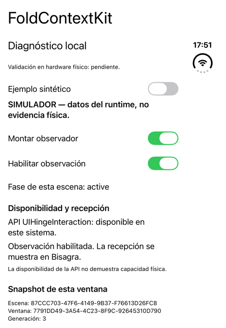
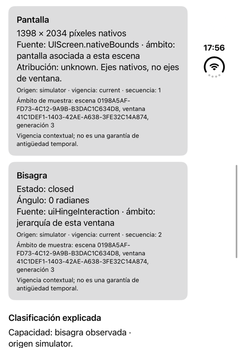

# FoldContextKit

Biblioteca Swift para observar la bisagra, inferir Duo y conocer el contexto de cada ventana: pantalla exterior, interior dividida o interior extendida. Tu app conserva el control de sus vistas y navegación.

Sin dependencias externas, Combine, telemetría ni permisos adicionales. Licencia [MIT](LICENSE).

## Tutorial rápido

### 1. Instalar

Requisitos: **Swift 6.4**, **iOS/iPadOS 26 o posterior**. Las APIs de bisagra y regiones reservadas requieren **27.1**; en versiones anteriores se informa de su indisponibilidad. El núcleo también admite macOS 26.

Repositorio: [lordzzz777/FoldContextKit](https://github.com/lordzzz777/FoldContextKit).

1. Abre tu app en Xcode.
2. Selecciona **File → Add Package Dependencies…**.
3. Introduce `https://github.com/lordzzz777/FoldContextKit.git`.
4. Selecciona la regla **Branch** y escribe **main**; todavía no hay una versión etiquetada.
5. Añade el producto **FoldContextKit** al target de tu app.

También puedes usar **Add Local…** y seleccionar la carpeta que contiene el `Package.swift` para trabajar con una copia local.

Después importa el módulo:

```swift
import FoldContextKit
```

La rama `main` contiene el desarrollo actual; no se presenta como una versión estable. Los límites de validación se detallan al final de este README.

### 2. Usar con SwiftUI

Aplica el modificador a una raíz estable de **cada ventana**. Este ejemplo muestra el modelo y la presentación recibidos:

```swift
import SwiftUI
import FoldContextKit

struct FoldStatusView: View {
    @State private var evidence: FoldEvidence?

    private var assessment: FoldAssessment? {
        evidence.map {
            FoldClassifier.evaluate(
                evidence: $0,
                interiorLayout: .extended
            )
        }
    }

    var body: some View {
        VStack(alignment: .leading, spacing: 12) {
            if let assessment {
                Text("Modelo: \(String(describing: assessment.model))")
                Text("Pantalla: \(String(describing: assessment.presentation.display))")
                Text("Modo: \(String(describing: assessment.presentation.mode))")
            } else {
                Text("Esperando datos de esta ventana…")
            }
        }
        .padding()
        .onFoldContextChange { event in
            switch event {
            case let .snapshot(value, _):
                evidence = value
            case .overflow:
                evidence = nil
            }
        }
    }
}
```

El modificador gestiona montaje y cancelación. No necesitas pedir al usuario que abra o cierre el dispositivo para iniciar la observación. Los textos anteriores muestran los valores de la API; tu app puede traducirlos y adaptar su interfaz.

### 3. Elegir interior dividido o extendido

Cambia el argumento `interiorLayout` del ejemplo:

| Elección de la app | Resultado en el interior |
| --- | --- |
| `.extended` | Una superficie continua |
| `.divided(axis: .horizontal)` | Dos regiones lado a lado |
| `.divided(axis: .vertical)` | Dos regiones apiladas |
| `.unspecified` | Sin atribuir una distribución a la app |

La pantalla exterior se mantiene como una sola región. La bisagra y su ángulo no obligan a elegir una distribución. Si la elección cambia durante la ejecución, conserva esa elección en el estado de la ventana y vuelve a evaluar el último snapshot.

Dentro del callback, puedes consultar las medidas y áreas para tu diseño:

```swift
let assessment = FoldClassifier.evaluate(
    evidence: value,
    interiorLayout: .divided(axis: .horizontal)
)

let presentation = assessment.presentation
let regions = presentation.regions
let contentAreas = presentation.unobscuredRegions
let source = presentation.regionSource
let hinge = presentation.hinge
```

Las coordenadas están en **puntos de la ventana**, no en píxeles de pantalla. La biblioteca prioriza las divisiones que comunica UIKit y las zonas seguras. Si utiliza dos mitades calculadas, lo indica con `appEqualSplit`; no las presenta como una bisagra medida. `unobscuredRegions` excluye las oclusiones observadas y puede devolver más de dos rectángulos. Un resultado vacío puede significar falta de datos, no falta de capacidad.

### Alternativa: UIKit

Retén un observador por controlador/ventana y vincúlalo al ciclo de vida:

```swift
import UIKit
import FoldContextKit

@MainActor
final class FoldStatusViewController: UIViewController {
    private let observer = FoldContextObserver()

    override func viewDidAppear(_ animated: Bool) {
        super.viewDidAppear(animated)
        observer.interiorLayout = .extended
        observer.onChange = { [weak self] _ in
            guard let self, let assessment = self.observer.assessment else {
                return
            }
            self.title = String(describing: assessment.model)
        }
        observer.start(in: view)
    }

    override func viewDidDisappear(_ animated: Bool) {
        super.viewDidDisappear(animated)
        observer.stop()
        observer.onChange = nil
    }
}
```

Para suspender temporalmente, usa `observer.isEnabled = false`. Para releer geometría si tu app la cambia sin generar layout, usa `observer.refresh()`. Cambiar `observer.interiorLayout` modifica la evaluación consultada; no genera un evento de hardware.

## Abrir otra ventana desde la app

En iOS, FoldContextKit incluye `FoldNewWindowButton` para SwiftUI y `FoldWindowActivation` para UIKit. Usan la activación nativa de escenas; no abren ventanas automáticamente al plegar ni convierten la multitarea de iOS en un escritorio macOS. La disponibilidad y colocación dependen del sistema, no de la clasificación Duo ni solo de su bisagra.

Configura soporte de múltiples escenas en tu app (`UIApplicationSceneManifest` → `UIApplicationSupportsMultipleScenes = YES`). La app también debe decidir qué escena recibe cada actividad. Ejemplo SwiftUI con un grupo dedicado:

```swift
import SwiftUI
import FoldContextKit

@main
struct ExampleApp: App {
    var body: some Scene {
        WindowGroup {
            WindowContent()
                .handlesExternalEvents(preferring: [], allowing: [])
        }
        .handlesExternalEvents(matching: ["com.example.app.window"])
    }
}

struct WindowContent: View {
    @State private var failure: String?

    var body: some View {
        VStack {
            FoldNewWindowButton(String(localized: "Abrir otra ventana"), userActivity: {
                let activity = NSUserActivity(activityType: "com.example.app.window")
                activity.targetContentIdentifier = UUID().uuidString
                return activity
            }, onFailure: { error in
                failure = String(describing: error)
            })
            if let failure { Text(failure) }
        }
    }
}
```

Cada instancia posee su propio estado. Los conjuntos vacíos en el modificador de la vista evitan que una escena abierta reciba la actividad en este ejemplo; el modificador del grupo selecciona el destino para una nueva escena. Adapta esta política si quieres reutilizar ventanas.

Desde UIKit, puedes instalar `FoldWindowActivation.makeAction(title:from:userActivity:onFailure:)` en un botón o menú. También puedes solicitar la activación explícitamente desde la escena del controlador:

```swift
if let scene = view.window?.windowScene {
    let activity = NSUserActivity(activityType: "com.example.app.window")
    activity.targetContentIdentifier = UUID().uuidString
    FoldWindowActivation.request(from: scene, userActivity: activity) { error in
        // Mostrar o registrar el error: aquí llega el error original del sistema.
        print(error)
    }
}
```

El consumidor UIKit configura su delegado de escenas y sus condiciones de activación. El botón nativo ofrece un error genérico si el sistema usa su acción alternativa; la solicitud directa conserva el error original. Solicitar una ventana no confirma que se haya creado: comprueba el ciclo de vida de la escena destino. iOS puede reutilizar una escena según la configuración de tu app.

## Ver la app de diagnóstico

Abre [RuntimeProbe.xcodeproj](Validation/RuntimeProbe/RuntimeProbe.xcodeproj), selecciona el esquema **RuntimeProbe** y un simulador iOS. La app muestra medidas, fuentes, bisagra, clasificación, regiones e historial. Mantén desactivado **Ejemplo sintético** para observar el entorno.

La app es un consumidor local del observador y de `FoldNewWindowButton`. La biblioteca proporciona ese control de activación, pero no selecciona el contenido ni la navegación de tus ventanas.

### Capturas del simulador

**Capturas históricas de Duo Simulator 27.1, del 27/10/2026.** Muestran la app de diagnóstico anterior a las últimas funciones de inferencia y regiones; no acreditan su funcionamiento actual ni hardware físico.

<p>
  
  
</p>

Izquierda: controles y disponibilidad de API. Derecha: medidas, bisagra y procedencia de las muestras. Estas pantallas pertenecen a RuntimeProbe; tu app diseña su propia interfaz.

## Cómo interpretar el resultado

- `duoDimensionCandidate`: dimensiones compatibles, sin una muestra admisible de bisagra.
- `duoInferred`: dimensiones compatibles y bisagra vigente del mismo contexto y origen.
- `insufficientInformation`: no hay evidencias suficientes para inferir el modelo.

La inferencia no es una identificación oficial ni una garantía de exclusividad futura. Captura activa o desconocida, pantallas externas identificadas y atribución desconocida bloquean la inferencia. Una escena `applicationDisplayUnresolved` puede permitir la heurística con captura inactiva, pero no certifica pantalla física integrada. El resultado conserva esa limitación. La app debe seguir funcionando con el espacio disponible aunque el modelo sea desconocido.

`nil` o ausencia de datos no demuestra ausencia de bisagra. Simulador, sistema y entradas sintéticas conservan su origen. Para observar capacidades sin inferir modelo, pasa `policy: .observationOnly`.

## Estado y documentación

Paquete y app compilados para iOS Simulator. **25 tests del núcleo superados en Mac** y consumidor SwiftPM local ejecutado. **47 casos superados en iOS Simulator**, sin fallos ni omisiones: cubren UIKit, SwiftUI y dos pruebas nuevas de activación de ventanas. En la app se observaron entrega inicial de bisagra, inferencia exterior, deshabilitación/reactivación y remontaje SwiftUI en simulador. También se observó suspensión al pasar a segundo plano y recepción de una muestra nueva al regresar. La lectura interior se obtuvo: 2007 × 2853 píxeles nativos con bisagra fullyOpen en simulador. Difiere del perfil interior implementado (1878 × 2670), por lo que allí el modelo queda desconocido. Quedan pendientes posturas libro/90° y la apertura efectiva de dos escenas con el nuevo botón; no hay dispositivo físico disponible. Detalles en la ficha técnica. Las pruebas controladas no acreditan comportamiento físico.

- [Ficha técnica](Documentation/FichaTecnica.md): contratos, fuentes, regiones, límites y resultados.
- [Checklist](Documentation/Checklist.md): trabajo completado y pendientes.
- [Licencia MIT](LICENSE).

El proyecto es independiente de SongBook/Lyrio. No incluye sus datos, recursos ni funciones, y no selecciona automáticamente las vistas de ninguna app.
